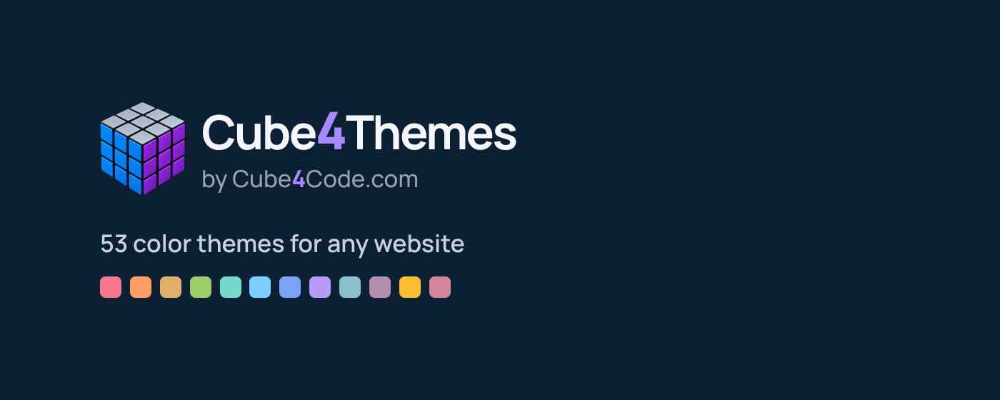
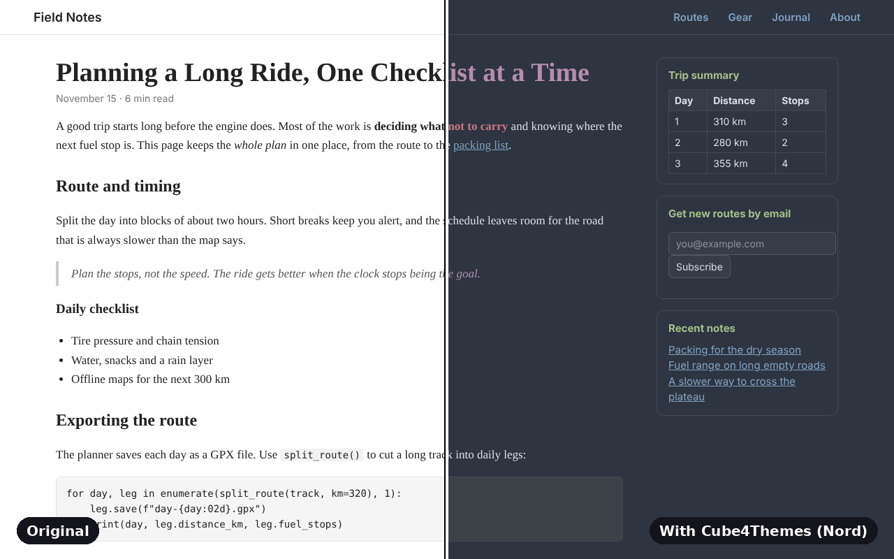

# Cube4Themes Extension

A browser extension for Chrome, Brave, Edge, Opera, Vivaldi and Firefox that applies the 53 themes of [Cube4Themes](https://github.com/robertoritter/Cube4Themes) to any website, for one site or for all of them. Many sites still have no dark mode; this one gives every page the colors you want to read in.

Versão em português: [README.pt-BR.md](README.pt-BR.md).



## Features

- 53 dark and light themes adapted from well-known terminal color schemes, with WCAG contrast checked for every reading color.
- Pick a theme for the current site only, or one theme for all sites. Turn it off on sites that already look good.
- Changes apply instantly, without reloading the page.
- Interface in English and Brazilian Portuguese, following the browser language.
- No data collection: choices are stored locally in the browser, with no network requests, analytics or remote code. See [PRIVACY.md](PRIVACY.md).

## Install

The extension is not in the Chrome Web Store or on addons.mozilla.org yet. Until then, build it and load it from source.

```bash
node build.mjs                 # creates build/chrome and build/firefox (Node 18+, no dependencies)
node build.mjs ../Cube4Themes  # optional: first refresh src/lib from a Cube4Themes clone
```

**Chrome, Brave, Edge, Opera, Vivaldi**

1. Open `chrome://extensions` (`brave://extensions`, `edge://extensions`...).
2. Turn on **Developer mode**.
3. Click **Load unpacked** and choose the `build/chrome` folder.
4. Pin the toolbar button and open any website.

**Firefox 140 or later**

1. Open `about:debugging#/runtime/this-firefox`.
2. Click **Load Temporary Add-on** and choose `build/firefox/manifest.json`.
3. Firefox turns off site access for MV3 extensions by default: open `about:addons`, select Cube4Themes, go to **Permissions** and allow access to all sites.
4. A temporary add-on is removed when Firefox closes.

After changing the code, reload the extension and the tab.

## How it works

- `src/lib/themes.css` (from Cube4Themes) defines the `--c4-*` variables of each theme, scoped to `<html data-c4-theme="...">`.
- `src/skin.css` maps any page element to those variables: background, text, headings, bold, links, code, quotes, tables and form fields. Images, video and SVG are left alone. The skin lives in a cascade layer (`@layer c4skin`), so its `!important` rules win over a site's own `!important` rules regardless of specificity.
- `src/content.js` reads the saved choice and sets or removes the `data-c4-theme` attribute. Without it, the style sheets do nothing. It also marks fixed and sticky headers that had their own background, so content does not show through them.
- `src/popup.*` lists the themes with color swatches and saves the choice in `storage.local`.

The only permission is `storage`. There is no background script, so the same code runs in every browser; only the Firefox manifest adds an ID and its data collection declaration.

## Known limitations

- Styles set with `!important` directly in an element's `style` attribute still win over the skin.
- On sites with a very designed layout, cards and buttons built with `div` elements can lose their outline.
- Dark icons (SVG, icon fonts or `mask-image`) can disappear on a dark theme.
- Content inside Shadow DOM is not reached by page CSS.
- Sites that are already dark get the theme on top; use "No theme" with "This site only" there.
- The choice is read asynchronously, so a page can flash its original colors for a moment while loading.
- Tabs opened before installing the extension need a reload.

## Store listing

`store/` holds the store material: 1280x800 screenshots, the store icon, promotional images and [STORE_LISTING.md](store/STORE_LISTING.md) with the form texts in English and Portuguese. To build the upload packages, run `node build.mjs` and zip the contents of `build/chrome` and `build/firefox` (with `manifest.json` at the root of each zip).

## Credits and license

The extension code is released under the [MIT License](LICENSE). Each color scheme belongs to its original author; see the credits in [Cube4Themes](https://github.com/robertoritter/Cube4Themes#credits). Cube4Themes and the four palette collections (iTerm2-Color-Schemes, Gogh, lucario, vim-deus) are MIT licensed, and the Manrope font is under the SIL Open Font License 1.1. Full texts are in `src/licenses/` and a summary in `src/THIRD_PARTY_NOTICES.txt`. The Cube4Code name and symbol are not covered by the MIT License.

Developed by **Roberto RITTER** at [Cube4Code](https://cube4code.com).
