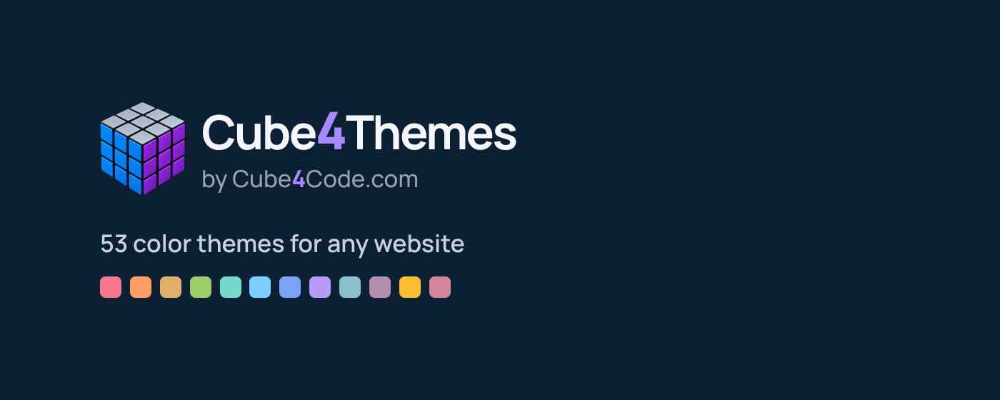
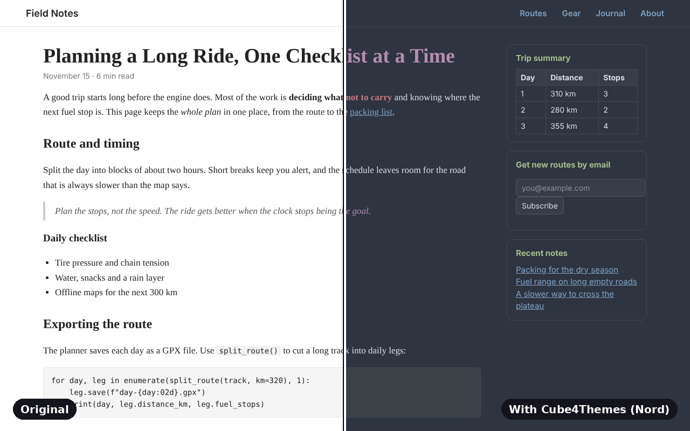
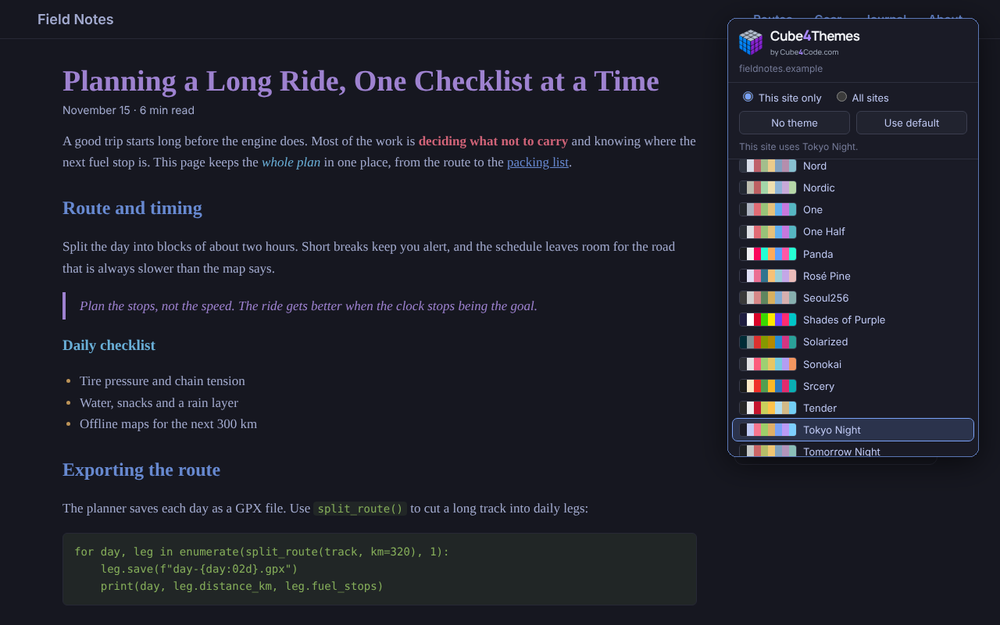
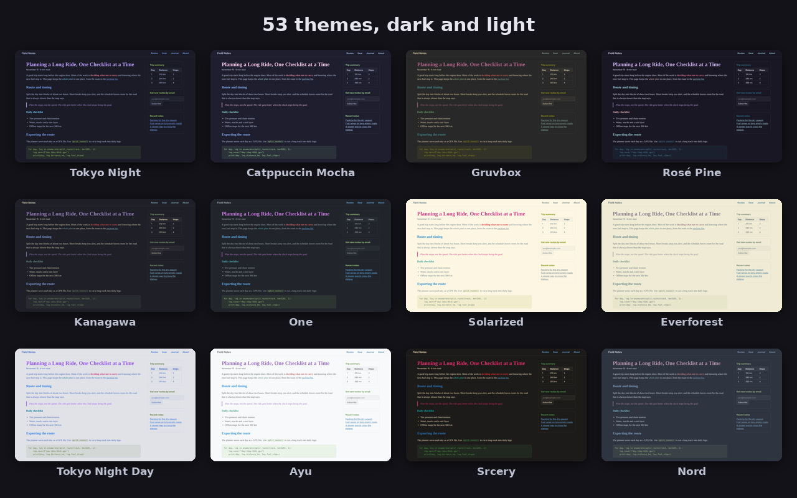
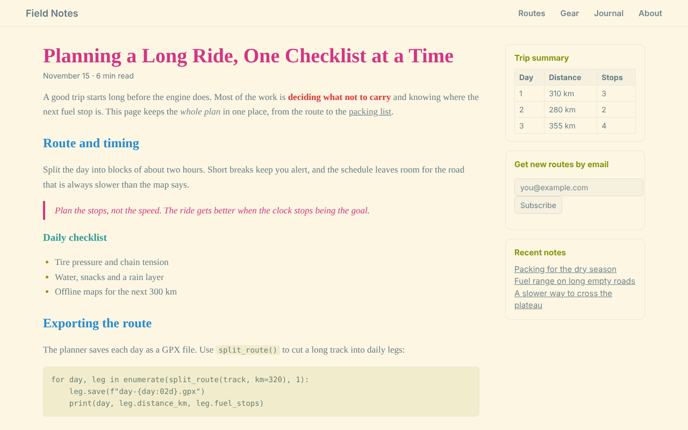
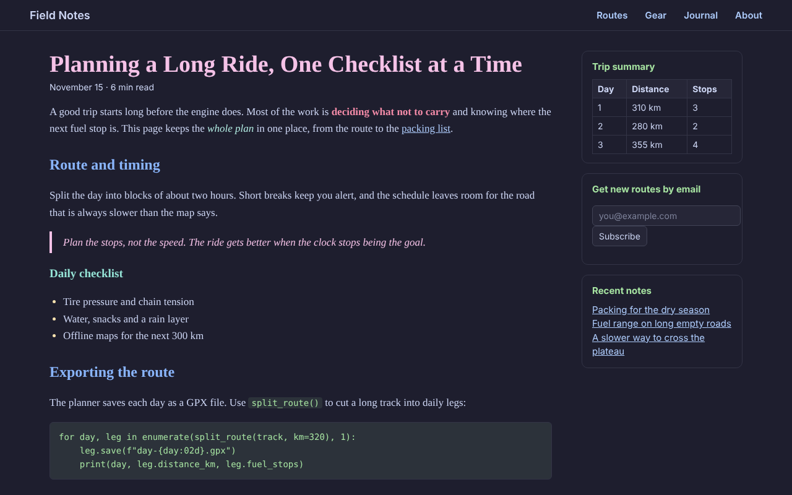

[English](README.md) | **Português**



# Cube4Themes Extension

Muitos sites ainda não têm modo escuro, e os que têm raramente combinam com o seu gosto. O Cube4Themes aplica um tema de cores completo em qualquer site, só no atual ou em todos, para cada página ficar do jeito que você prefere ler. Funciona no Chrome, Brave, Edge, Opera, Vivaldi e Firefox.



## Recursos

- **53 temas, escuros e claros**, adaptados de esquemas de cores de terminal conhecidos, como Tokyo Night, Nord, Catppuccin e Solarized.
- **Legível por definição:** cada cor de texto é conferida contra o fundo para atingir um contraste mínimo (WCAG).
- **Por site ou em todos:** escolha um tema só para o site atual ou um tema para todos os sites. Desligue onde o site já está bom.
- **Na hora:** a mudança aparece sem recarregar a página.
- **Inglês e português**, seguindo o idioma do navegador.

## Imagens

| | |
|---|---|
|  |  |
| Escolha um tema só para este site ou para todos, direto da barra de ferramentas. | 53 temas, escuros e claros, adaptados de esquemas de cores de terminal conhecidos. |
|  |  |
| Temas claros também: Solarized Light. | Um tema escuro num site sem modo escuro: Catppuccin Mocha. |

## Instalar

- **Chrome, Brave, Edge, Opera, Vivaldi:** [Cube4Themes na Chrome Web Store](https://chromewebstore.google.com/search/Cube4Themes), depois **Usar no Chrome**.
- **Firefox:** [Cube4Themes nos complementos do Firefox](https://addons.mozilla.org/pt-BR/firefox/addon/cube4themes/), depois **Adicionar ao Firefox**.

## Como usar

1. Fixe o botão do Cube4Themes na barra de ferramentas.
2. Abra qualquer site e clique no botão.
3. Escolha **Só este site** ou **Todos os sites** e clique num tema. A página muda na hora.
4. **Sem tema** desliga; **Usar o padrão** faz o site voltar a seguir o tema de todos os sites.

## Privacidade

O Cube4Themes não coleta nem envia dados. Suas escolhas de tema ficam no seu navegador. Não há requisições de rede, análise de uso nem código remoto. Política completa: [PRIVACY.md](PRIVACY.md).

## Limites conhecidos

- Sites com layout muito desenhado podem perder alguns contornos de cartões e botões.
- Ícones escuros podem ficar difíceis de ver num tema escuro.
- Sites que já são escuros recebem o tema por cima; neles, use **Sem tema** com **Só este site**.
- A página pode mostrar as cores originais por um instante ao carregar.
- Abas abertas antes de instalar a extensão precisam ser recarregadas.

Achou um site que ficou estranho? [Abra uma issue](https://github.com/robertoritter/Cube4Themes-Extension/issues) com o endereço.

## Desenvolvimento

A extensão é JavaScript e CSS puros (Manifest V3), sem dependências e sem bundler. O Node 18 ou mais novo só é necessário para o script de build.

```bash
node build.mjs                 # gera build/chrome e build/firefox
node build.mjs ../Cube4Themes  # opcional: antes atualiza src/lib a partir de um clone do Cube4Themes
```

**Instalar a partir do código no Chrome, Brave, Edge, Opera ou Vivaldi:** abra `chrome://extensions`, ligue o **Modo do desenvolvedor**, clique em **Carregar sem compactação** e escolha `build/chrome`.

**Instalar a partir do código no Firefox 140 ou mais novo:** abra `about:debugging#/runtime/this-firefox`, clique em **Carregar extensão temporária** e escolha `build/firefox/manifest.json`. Depois, em `about:addons`, abra a Cube4Themes, aba **Permissões**, e libere o acesso a todos os sites. A extensão temporária some quando o Firefox fecha.

**Como funciona**

- `src/lib/themes.css` (do [Cube4Themes](https://github.com/robertoritter/Cube4Themes)) define as variáveis `--c4-*` de cada tema, presas a `<html data-c4-theme="...">`.
- `src/skin.css` liga qualquer elemento da página a essas variáveis, sem tocar em imagens, vídeos e SVG. Ela fica numa cascade layer (`@layer c4skin`), então os `!important` dela vencem os `!important` do site, independente da especificidade.
- `src/content.js` coloca ou tira `data-c4-theme` conforme a escolha salva, e marca cabeçalhos fixos e grudados que tinham fundo próprio para o conteúdo não aparecer por trás deles.
- `src/popup.*` lista os temas e grava a escolha em `storage.local`. A única permissão é `storage`, e não há background script.

**Material das lojas:** `store/` guarda as screenshots, as imagens promocionais e o [STORE_LISTING.md](store/STORE_LISTING.md) com os textos dos formulários. Os pacotes de envio são o conteúdo de `build/chrome` e `build/firefox`, compactado com o `manifest.json` na raiz.

## Créditos e licença

O código da extensão é distribuído sob a [licença MIT](LICENSE). Cada esquema de cores pertence ao seu autor original; veja os créditos no [Cube4Themes](https://github.com/robertoritter/Cube4Themes#credits). O Cube4Themes e as quatro coleções de paletas (iTerm2-Color-Schemes, Gogh, lucario, vim-deus) são MIT, e a fonte Manrope está sob a SIL Open Font License 1.1. Os textos completos estão em `src/licenses/` e o resumo em `src/THIRD_PARTY_NOTICES.txt`. O nome e o símbolo da Cube4Code não estão cobertos pela licença MIT.

Desenvolvido por **Roberto RITTER** na [Cube4Code](https://cube4code.com).
